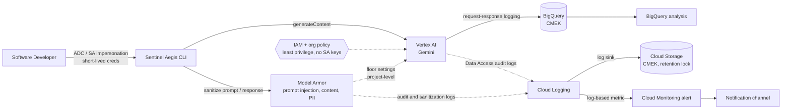

# Sentinel Aegis CLI

Sentinel Aegis CLI is a Python CLI tool that routes prompts to an LLM on Google Cloud (Vertex AI) through a locked-down, audited, guardrail-enforced path. Nowadays software developers need a safe, monitored way to use an LLM. Raw API access is not acceptable because they could leak sensitive data, or the model could be attacked through prompt injection.

Sentinel Aegis CLI provides that path:

- Prompts go through a CLI that calls Gemini on Vertex AI.
- Every prompt and response is screened by a Google Cloud Model Armor.
- Project-level Model Armor floor settings and IAM make the screening hard to skip by calling Vertex AI directly (coverage to be verified, see Limitations).
- Every interaction is logged to CMEK-encrypted storage (BigQuery and Cloud Storage) for audit purpose.

## Goals

- Build a practical, end-to-end LLM security architecture on Google Cloud.
- Enforce controls server-side (Model Armor floor settings, IAM, org policy), not only in client code.
- Optionally port the design to AWS Bedrock and compare the two platforms.
- Define all infrastructure as code so it is reproducible.
- Validate defenses with automated red-team tests.
- Document the threat model, findings, and limitations honestly.

## Architecture



## Security Controls

| Area                  | Control                                                                                                                                                       |
| --------------------- | ------------------------------------------------------------------------------------------------------------------------------------------------------------- |
| Identity              | Application Default Credentials via user login or service account impersonation (Workload Identity Federation for CI); no downloaded service account keys     |
| Org policy            | `iam.disableServiceAccountKeyCreation` and related constraints; dedicated project for the workload                                                            |
| Least privilege       | Custom or narrowly scoped roles for Vertex AI invocation and Model Armor usage; no project-wide Owner/Editor for users                                        |
| Guardrail enforcement | Model Armor floor settings at project level with Vertex AI integration enabled; verify which APIs and models are covered                                      |
| Prompt attacks        | Model Armor prompt injection and jailbreak filter with a tuned confidence threshold                                                                           |
| Content safety        | Model Armor responsible AI filters (hate, harassment, sexually explicit, dangerous content)                                                                   |
| Data protection       | Model Armor Sensitive Data Protection (mask or block emails, card numbers, credentials) on prompts and responses                                              |
| Audit logging         | Vertex AI request-response logging to BigQuery; Cloud Audit Logs (Data Access) for Vertex AI and Model Armor                                                  |
| Log protection        | CMEK via Cloud KMS, uniform bucket-level access, public access prevention, log sink to Cloud Storage with a locked retention policy, tight access to log data |
| Detection             | BigQuery queries, log-based metrics, Cloud Monitoring alert policies, notification channels                                                                   |
| Cost / abuse          | Cloud Billing budget alert, quotas, token caps and basic rate limiting in the CLI                                                                             |

## Planned Repository Structure

```
.
├── infra/          # Terraform: project, IAM, KMS, logging, BigQuery, Model Armor, alerts
├── cli/            # Sentinel Aegis CLI source and unit tests
├── redteam/        # Prompt corpus and automated test runner
├── analysis/       # BigQuery queries and alert definitions
└── docs/           # Threat model, findings, architecture diagram, AWS comparison
```

## Roadmap

- [ ] **Phase 1 - Infrastructure as Code:** Project, APIs, IAM, KMS, log storage, request-response logging, audit logs
- [ ] **Phase 2 - CLI:** Python CLI calling Gemini on Vertex AI with Model Armor screening
- [ ] **Phase 3 - Enforcement:** Model Armor floor settings, org policy, and IAM so screening cannot be skipped
- [ ] **Phase 4 - Red teaming:** Automated prompt corpus with expected outcomes
- [ ] **Phase 5 - Detection:** BigQuery queries, log-based metrics, alert policies
- [ ] **Phase 6 - Write-up:** Threat model, findings, and lessons learned
- [ ] **Phase 7 (optional) - AWS port:** Rebuild on Bedrock Guardrails and compare enforcement, logging, and detection

### Phase details

**Phase 1 - Infrastructure as Code**

- Dedicated GCP project with required APIs enabled (Vertex AI, Model Armor, Cloud KMS, Logging, BigQuery, Monitoring, Sensitive Data Protection).
- Least-privilege IAM and service account impersonation; org policy blocking service account key creation where possible.
- Cloud KMS key (CMEK) for BigQuery and Cloud Storage.
- Vertex AI request-response logging to a BigQuery dataset, and Data Access audit logs enabled.
- Log sink to a private Cloud Storage bucket with public access prevention and a locked retention policy.
- Confirm the chosen Gemini model and Model Armor are available in the chosen region.

**Phase 2 - CLI**

- Google Gen AI / Vertex AI Python SDK client for Gemini, plus the Model Armor client.
- Input via `argparse` or `click`.
- Screen the user prompt and the model response against the Model Armor template; fail closed if screening errors.
- Surface the filter result so blocked requests show the reason.
- Token cap and basic rate limiting.

Example usage goal:

```bash
aegis --prompt "Write a python script to sort a list"
```

**Phase 3 - Enforcement**

- Configure Model Armor floor settings at project level with Vertex AI integration in inspect-and-block mode.
- Restrict who can invoke Vertex AI and who can change Model Armor settings and templates.
- Verify that a direct call to Vertex AI (for example with `gcloud` or `curl`, bypassing the CLI) is still screened.
- Document exactly which models and APIs are and are not covered.

**Phase 4 - Red teaming**

- Baseline: a normal prompt returns a valid response.
- Jailbreak / prompt injection: blocked with the configured message.
- Data leak: fake credit card numbers and fake cloud credentials are masked or blocked.
- Audit: blocked prompts and intervention reasons appear in the logs.
- Check whether raw PII appears unmasked in the request-response logs.
- Candidate tools: promptfoo, garak, PyRIT, plus unit tests with mocked Google client libraries.

**Phase 5 - Detection**

- BigQuery queries over the request-response logs and audit logs.
- Log-based metric and Cloud Monitoring alert policy on guardrail interventions.
- Notification when one principal triggers repeated blocks.

**Phase 6 - Write-up**

- Map controls to the [OWASP Top 10 for LLM Applications](https://owasp.org/www-project-top-10-for-large-language-model-applications/).
- Document gaps: indirect prompt injection, output handling, denied topics, and similar.

**Phase 7 (optional) - AWS port**

- Rebuild with Bedrock Guardrails, `Converse`, and an IAM condition on `bedrock:GuardrailIdentifier`.
- Compare enforcement model, logging, PII handling, and detection tooling between the two clouds.

## Prerequisites

- A Google Cloud account with billing enabled (free trial credits may cover most of this project)
- `gcloud` CLI authenticated with Application Default Credentials
- Python 3.11+
- Terraform with the `google` provider
- Vertex AI and Model Armor availability in your chosen region

## Getting Started

_To be added once the infrastructure and CLI exist._

## Cost Notice

Vertex AI, Model Armor, BigQuery, Cloud Storage, Cloud KMS, and Cloud Logging all incur charges. Set a Cloud Billing budget alert before running tests, and tear down resources when not in use.

## Threat Model and Limitations

_To be added in `docs/`. Initial known limitations:_

- Guardrails reduce risk but are not a complete defense against prompt injection.
- GCP has no direct equivalent of AWS's `bedrock:GuardrailIdentifier` IAM condition. Server-side enforcement relies on Model Armor floor settings, whose coverage of specific models and APIs must be verified.
- Request-response logs contain raw prompts and responses and must be treated as sensitive data.
- Indirect prompt injection (via documents or tools) is out of scope initially.

## Disclaimer

This is a personal learning project. Red-team prompts and test data are for validating defenses on your own account only. Use fake PII and fake credentials in tests.

## License

TBD
